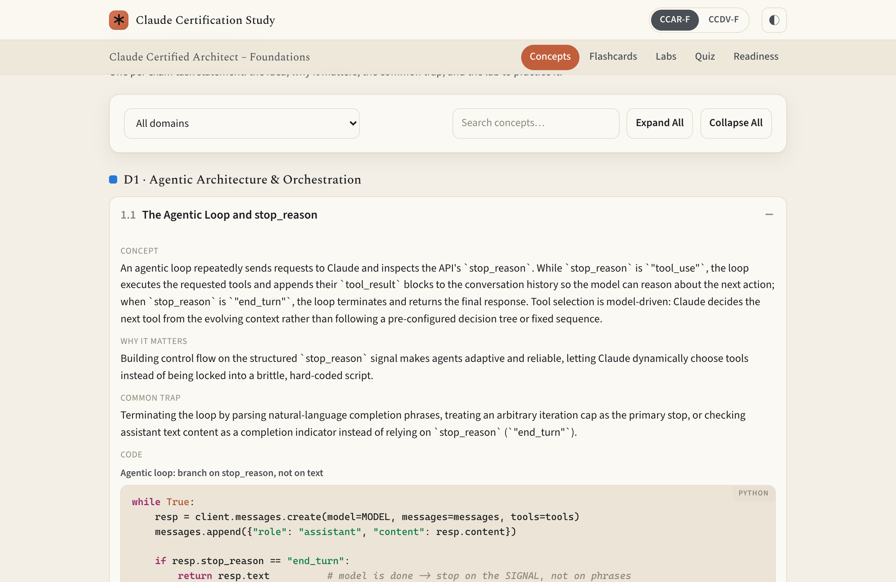

# Claude Certification Exam Prep (Anthropic, 2026)



Study materials, hands-on labs, and a fully offline study app for Anthropic's Claude
certifications. The repo is built to hold **any number of exams**: content lives in
reusable, versioned components that each exam pins, and the study app, CLI, and TUI
switch between exams.

| Exam | Code | Status |
|------|------|--------|
| Claude Certified Architect – Foundations | **CCAR-F** | Complete — guide, 25 labs, full study content |
| Claude Certified Developer – Foundations | **CCDV-F** | Complete — guide, full study content; links the 19 labs that fit its skills |

**CCAR-F** validates practical judgment about building production applications with
**Claude Code, the Claude Agent SDK, the Claude API, and the Model Context Protocol
(MCP)**. This repo pairs its official exam guide with two ways to prepare: a
buildable, testable **lab curriculum** and a polished, fully offline **study app** (a
three-tier practice quiz with real "Select N" multi-response items, flashcards,
concept explainers, browsable labs, and a readiness dashboard) — so you gain
hands-on experience with *every* feature, concept, and topic the exam covers,
not just read about them.

## By the Numbers

| Exam | Practice Questions | Flashcards | Concept Explainers | Hands-On Labs |
|:--|:--:|:--:|:--:|:--:|
| **CCAR-F** | **435** | **135** | **30** | **25** |
| **CCDV-F** | **322** | **93** | **25** | **19** linked |

Both exams draw from one shared content pool (**639** questions, **196** flashcards,
**55** concept explainers; 150 items serve both exams), each through its own item map.
Questions span three difficulty tiers — CCAR-F: **Standard** (240), **Intermediate**
(120), and **Hard** (75, including 10 multi-response "Select N" items calibrated to the
real exam's format); CCDV-F: Standard (192), Intermediate (65), and Hard (65, including
18 "Select N") — dynamically selectable in the Web UI, or chosen with `--set` (any
combination) in the CLI/TUI. CCAR-F covers all **5 exam domains** and **30 task
statements** (40 syntax-highlighted code samples across its concept explainers);
CCDV-F covers all **8 domains** and **25 skills**, with Standard-tier questions per
skill scaled to the skill's exam weight (24 code samples). Questions and concepts
link to the lab that drills them where one exists. The whole study app runs locally
and offline, with zero runtime dependencies.

## Study Materials

| Path | What it is |
|------|------------|
| [`study/exams/ccarf/anthropic-ccarf-exam-guide-2026-07.md`](study/exams/ccarf/anthropic-ccarf-exam-guide-2026-07.md) | The CCAR-F exam guide: 5 domains, 30 task statements, 6 scenarios, sample questions, prep exercises. Each exam's guide and manifest live in `study/exams/<exam>/`. |
| [`labs/`](labs/) | 25 hands-on CCAR-F labs + a shared test harness. Start at [`labs/README.md`](labs/README.md). |
| [`labs/README.md`](labs/README.md) | Master matrix: labs by dependency tier & difficulty, with effort estimates and a full task-statement → lab / scenario → capstone traceability map. |
| [`labs/_shared/`](labs/_shared/) | Reusable test harness (deterministic mock Claude client, `starter`/`solution` switching, opt-in LLM grading). See [`labs/_shared/README.md`](labs/_shared/README.md). |
| [`study/`](study/) | A local, offline, multi-exam study app — a 3-tier practice quiz (Standard/Intermediate/Hard, with multi-select items), flashcards with self-graded recall tracking, concept explainers (with code samples), browsable labs, and a readiness dashboard. Web UI (`uv run study/serve.py`) plus standalone CLI/TUI quiz and flashcard tools. See [`study/README.md`](study/README.md). |
| `.claude/` | Project Claude Code config (enables the `pyright-lsp` and `agent-sdk-dev` plugins). |

## Labs At A Glance

- **25 labs** across 5 dependency tiers (Foundations → Capstones), ordered so
  prerequisites come first, then by difficulty (1–10). ~48 hours of hands-on effort.
- **Full coverage:** every task statement (1.1–5.6) and every exam scenario (S1–S6)
  maps to at least one lab — see the traceability tables in [`labs/README.md`](labs/README.md).
- **Each lab folder** contains: `README.md` (instructions), `SOLUTION.md` (reference
  key + why-the-distractors-are-wrong), `starter/` (scaffold you fill in), `solution/`
  (reference implementation), `tests/` (automated checks), and any config artifacts
  (`.claude/rules`, `.mcp.json`, `SKILL.md`, CI YAML, sample docs).
- **Tests are deterministic and offline by default:** labs mock the Claude API via
  `labs/_shared/mock_anthropic.py`, so a plain test run needs no API key and costs
  nothing. A handful of inherently semantic checks are marked `llm` and run only when
  you opt in with an API key.

## Prerequisites

- [`uv`](https://docs.astral.sh/uv/) — drives all Python scripts and tests (no manual venv needed)
- [Claude Code](https://docs.claude.com/claude-code) — for the configuration-oriented labs
- Optional: an `ANTHROPIC_API_KEY` to exercise the live end-to-end and `-m llm` paths

## Quick Start

First install [`uv`](https://docs.astral.sh/uv/) — macOS/Linux: `curl -LsSf https://astral.sh/uv/install.sh | sh`; Windows (PowerShell): `irm https://astral.sh/uv/install.ps1 | iex` ([full guide](https://docs.astral.sh/uv/getting-started/installation/)).

```bash
git clone https://github.com/craigforr/cert-anthropic-2026
cd cert-anthropic-2026

# The study app (quiz, flashcards, concepts, labs, readiness):
uv run study/serve.py                     # opens http://localhost:8000/web/

# The labs:
cd labs
uv run pytest lab-03-agentic-loop        # test YOUR work on one lab (its starter/)
uv run pytest                            # test your work across all labs
LAB_TARGET=solution uv run pytest        # run the reference solutions (all green)
ANTHROPIC_API_KEY=sk-... uv run pytest -m llm   # add the optional semantic checks
```

Suggested workflow per lab: read its `README.md` (note prerequisites) → fill in
`starter/` until `uv run pytest lab-NN-...` passes → compare against `SOLUTION.md`
and `solution/` for the *why*, not just the *what*.

## Study Path

Work the labs in the order given in [`labs/README.md`](labs/README.md) (dependency
tier, then difficulty). Tier 0–1 build the core primitives (agentic loop, tool use,
structured output, Claude Code config); Tier 2–3 layer on error handling,
orchestration, and context management; the Tier 4 capstones integrate everything
into the six exam scenarios.

## Notes

- CCAR-F content is derived from the publicly distributed CCAR-F exam guide.
- Test suite status: `LAB_TARGET=solution uv run pytest` → 376 passed, 3 `llm`-marked
  tests deselected (they run only with an API key).
